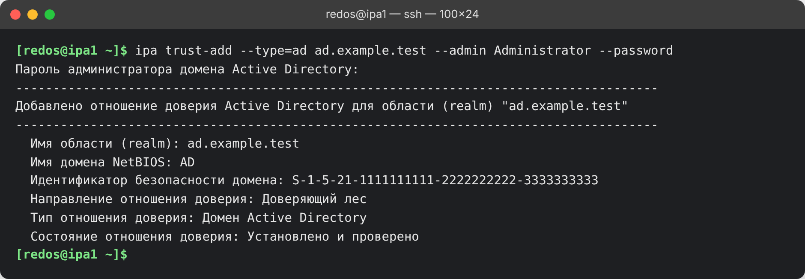
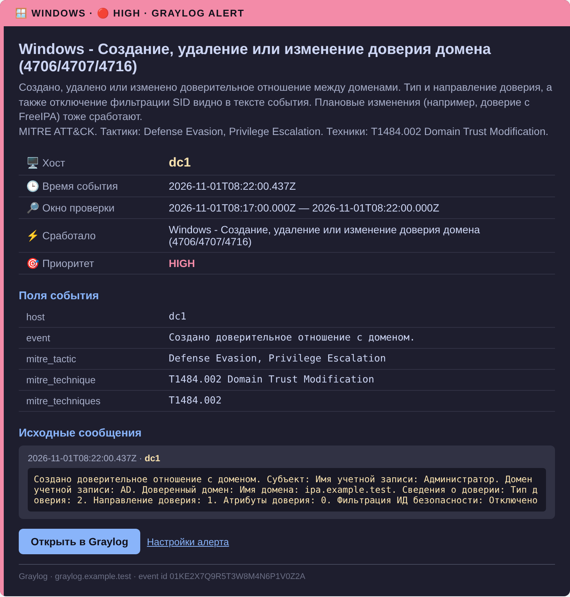

<p align="center">
  
  
  
  
  
</p>

# 🤝 Доверие между FreeIPA на РЕД ОС 8.0.3 и Active Directory на Windows Server 2025

> Пошаговая инструкция: как связать домен FreeIPA на РЕД ОС с доменом Windows Server 2025 так, чтобы
> пользователи AD входили на хосты IPA. С DNS, Samba, группами, HBAC, диагностикой типовых ошибок и
> мониторингом доверий в Graylog. Проверено на реальной домашней лаборатории.

## 📑 Оглавление

- [Зачем это](#-зачем-это)
- [Главная находка: две сборки Samba в РЕД ОС](#-главная-находка-две-сборки-samba-в-ред-ос)
- [Как это выглядит](#-как-это-выглядит)
- [Схема лаборатории](#-схема-лаборатории)
- [Главы](#-главы)
- [Быстрая шпаргалка](#-быстрая-шпаргалка)
- [Одностороннее или двустороннее](#-одностороннее-или-двустороннее)
- [Мониторинг доверий](#-мониторинг-доверий)
- [Лицензия](#-лицензия)

## 🎯 Зачем это

В домашней или небольшой корпоративной сети часто живут два каталога: Windows-домен для рабочих станций и
FreeIPA для Linux-хостов. Доверие (trust) позволяет одним и тем же учётным записям AD входить на хосты
FreeIPA по SSH, получать Kerberos-билеты и попадать в правила доступа (HBAC) и sudo, не заводя вторую
учётную запись.

Типовые инструкции написаны под RHEL и Fedora. На РЕД ОС есть свои особенности, из-за которых «по учебнику»
доверие не создаётся. Этот репозиторий собирает путь, который прошёл от нуля до рабочего доверия, вместе с
ошибками и их причинами.

## ⚠️ Главная находка: две сборки Samba в РЕД ОС

Если `ipa trust-add` падает с ошибкой

```
ipa: ERROR: Ошибка обмена данными с сервером CIFS: код "3221225485",
сообщение "An invalid parameter was passed to a service or function."
```

(это `0xC000000D`, `STATUS_INVALID_PARAMETER`), причина, скорее всего, в сборке Samba. В репозитории РЕД ОС
одна и та же версия Samba собрана дважды:

| Суффикс | Kerberos в сборке | Подходит для FreeIPA |
|---|---|---|
| `…-4h.red80` | Heimdal | нет |
| `…-3m.red80` | MIT | да |

FreeIPA работает на MIT Kerberos, а в Samba 4.23 появилась логика с `kinit` по паролю, которая с Heimdal-сборкой
и кэшем билетов через gssproxy ломает вызов. Откат на MIT-сборку чинит создание доверия. Подробности и
команды: [глава 3](docs/03-samba-redos.md). Для сравнения, та же ошибка описана как баг Samba 4.23 в
[FreeIPA #9847](https://www.pagure.io/freeipa/issue/9847) и
[Red Hat Bugzilla 2392626](https://bugzilla.redhat.com/show_bug.cgi?id=2392626).

## 🖼️ Как это выглядит

<table>
  <tr>
    <td align="center"><b>Создание доверия</b><br></td>
    <td align="center"><b>Письмо алерта Graylog</b><br></td>
  </tr>
</table>

На снимках реальный вывод и реальное событие, имена доменов, хостов и SID заменены на вымышленные.

## 🗺️ Схема лаборатории

В примерах используются вымышленные имена. Подставь свои.

| Что | Значение в примерах |
|---|---|
| Домен FreeIPA | `ipa.example.test`, realm `IPA.EXAMPLE.TEST` |
| Сервер FreeIPA | `ipa1.ipa.example.test`, `192.0.2.10`, РЕД ОС 8, FreeIPA 4.12.2 |
| Домен Active Directory | `ad.example.test`, NetBIOS `AD` |
| Контроллер домена | `dc1.ad.example.test`, `192.0.2.20`, Windows Server 2025 Standard |
| Администратор AD | `Administrator` в примерах; в лаборатории автора это встроенная «Администратор», у тебя может быть другая учётная запись с правами администратора домена |

## 📚 Главы

| № | Глава | О чём |
|---|---|---|
| 1 | [Подготовка: DNS, время, порты](docs/01-prepare.md) | Зона-переадресация на IPA, условный пересыльщик на DC, DNSSEC, синхронизация времени, firewalld |
| 2 | [Установка поддержки доверия](docs/02-adtrust-install.md) | `ipa-server-trust-ad`, `ipa-adtrust-install --add-sids`, проверка |
| 3 | [Samba для РЕД ОС: MIT, а не Heimdal](docs/03-samba-redos.md) | Откат на MIT-сборку, фиксация версии |
| 4 | [Создание доверия](docs/04-create-trust.md) | Одностороннее и двустороннее, пересоздание, проверка |
| 5 | [Группы AD и HBAC](docs/05-groups-hbac.md) | Внешняя группа, вход пользователей AD на хосты IPA |
| 6 | [Диагностика ошибок](docs/06-troubleshooting.md) | Таблица кодов и причин, что проверять |
| 7 | [Мониторинг доверий в Graylog](docs/07-monitoring.md) | События 4706, 4707, 4716, алерты, ссылки на детекты |
| 8 | [Тестовые пользователи для обоих доменов](docs/08-test-users.md) | Генератор и импортёры для IPA и AD: случайные ФИО, группы отделов, очистка |

## ⚡ Быстрая шпаргалка

```bash
# 1. DNS: на IPA зона-переадресация на AD, на DC условный пересыльщик на IPA
ipa dnsforwardzone-add ad.example.test --forwarder=192.0.2.20 --forward-policy=only

# 2. Поддержка доверия на сервере IPA
sudo dnf install -y ipa-server-trust-ad
sudo ipa-adtrust-install --add-sids
sudo firewall-cmd --permanent --add-service=freeipa-trust && sudo firewall-cmd --reload

# 3. Samba только MIT-сборки (в РЕД ОС суффикс «m», не «h»)
rpm -q samba

# 4. Доверие
kinit admin
ipa trust-add --type=ad ad.example.test --admin Administrator --password

# 5. Проверка
ipa trust-show ad.example.test
id Administrator@ad.example.test
```

> **Про учётную запись.** Везде в примерах стоит `Administrator`. В моей лаборатории на русской Windows встроенная
> учётная запись называется «Администратор», и именно её я указывал в `--admin`. У тебя имя может быть другим:
> подставь любую учётную запись с правами администратора домена AD (то же касается имён групп вроде
> `Domain Admins` / «Администраторы домена»).

Каждый шаг подробно разобран в главах, там же частые ошибки.

## 🔀 Одностороннее или двустороннее

- **Одностороннее** (по умолчанию): IPA доверяет AD. Пользователи AD могут работать с ресурсами IPA, обратное
  неверно. Этого достаточно для входа AD-пользователей на Linux-хосты.
- **Двустороннее** (`--two-way=true`): дополнительно AD доверяет IPA. Оно не позволяет пользователям IPA
  входить на Windows и не даёт AD-пользователям дополнительных прав. Нужно приложениям, которым требуется
  Kerberos-делегирование S4U2Self и S4U2Proxy через границу доверия (например, Microsoft SQL Server).

Подробнее: [глава 4](docs/04-create-trust.md).

## 🔍 Мониторинг доверий

Создание, удаление и изменение доверия видно с двух сторон: в журнале Security контроллера домена (события 4706,
4707, 4716) и в API-журнале FreeIPA (`trust_add`, `trust_del`). Готовые алерты Graylog с привязкой к MITRE
ATT&CK (T1484.002, Domain Trust Modification) описаны в репозитории детектов:

- [Graylog как домашний SIEM](https://github.com/ArsIS-02/Graylog_streams-alerts), корень репозитория;
- [глава про Windows: аудит DC и алерты Active Directory](https://github.com/ArsIS-02/Graylog_streams-alerts/blob/main/docs/03-windows.md#контроллер-домена-аудит-и-16-алертов-волна-2);
- [каталог всех детектов](https://github.com/ArsIS-02/Graylog_streams-alerts/blob/main/docs/14-detections.md).

Как включить аудит и настроить сбор событий, читай в [главе 7](docs/07-monitoring.md).

## 📄 Лицензия

[GPL-3.0](LICENSE)
