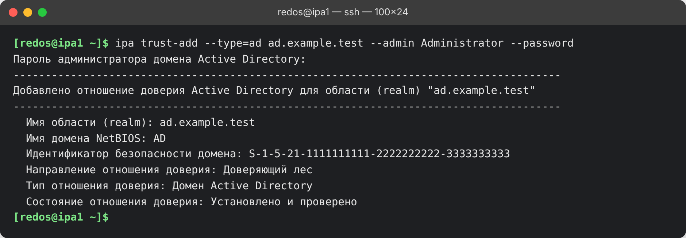
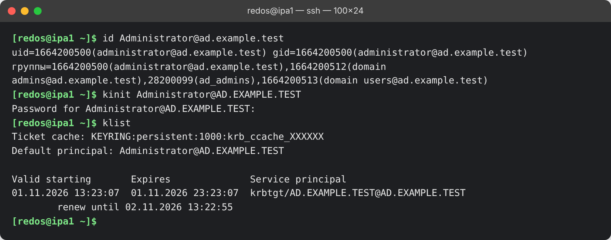

# Глава 4. Создание доверия

Перед началом убедись, что выполнены главы 1–3: DNS работает в обе стороны, часы синхронны, поддержка доверия
установлена, Samba на MIT-сборке.

## 4.1. Одностороннее доверие (по умолчанию)

```bash
kinit admin
ipa trust-add --type=ad ad.example.test --admin Administrator --password
```

Команда попросит пароль администратора домена AD. Это должна быть учётная запись с правами администратора
домена. В русской Windows встроенная учётная запись называется «Администратор»: её можно указать по-русски,
`--admin Администратор`. Пароль вводи без вставки лишних символов: опечатка приводит к ошибке
`0xC000006D` ([глава 6](06-troubleshooting.md)).

Успешный результат:

```
Добавлено отношение доверия Active Directory для области (realm) "ad.example.test"
  Имя области (realm): ad.example.test
  Имя домена NetBIOS: AD
  Идентификатор безопасности домена: S-1-5-21-...
  Направление отношения доверия: Доверяющий лес
  Тип отношения доверия: Домен Active Directory
  Состояние отношения доверия: Установлено и проверено
```

«Доверяющий лес» означает: IPA доверяет лесу AD. Пользователи AD получают доступ к ресурсам IPA.



*Вывод реальной команды. Имена доменов, SID и пользователя заменены на вымышленные.*

## 4.2. Двустороннее доверие

```bash
ipa trust-add --type=ad ad.example.test --admin Administrator --password --two-way=true
```

Направление в выводе: «Двустороннее отношение доверия». Практически оно нужно только приложениям с S4U-
делегированием; пользователям IPA вход на Windows оно не открывает.

## 4.3. Как сменить направление

Направление «на лету» не меняется, доверие пересоздаётся:

1. На IPA: `ipa trust-del ad.example.test`.
2. На DC: «Active Directory — домены и доверие» → свойства домена → вкладка «Отношения доверия» → выбери
   домен IPA → «Удалить». Без этого создание упрётся в остаток доверия. Проверь командой
   `Get-ADTrust -Filter * | Format-List Name,Direction,TrustType`.
3. Создай доверие заново нужной командой из 4.1 или 4.2.

Пока доверия нет, вход пользователей AD на хосты IPA не работает. Внешняя группа и правила HBAC из
[главы 5](05-groups-hbac.md) при пересоздании сохраняются.

## 4.4. Проверка

```bash
ipa trust-show ad.example.test
ipa trustdomain-find ad.example.test
id Administrator@ad.example.test
kinit Administrator@AD.EXAMPLE.TEST
klist
kdestroy
```

`id` должен показать пользователя AD с его группами (идентификаторы вида `1664200500`, префикс зависит от
диапазона, выбранного IPA) и, если настроена [глава 5](05-groups-hbac.md), IPA-группу. Если пользователя не
находит, подожди минуту или сбрось кэш SSSD: `sudo sss_cache -E`. `kinit` должен выдать билет
`krbtgt/AD.EXAMPLE.TEST@AD.EXAMPLE.TEST`.



*Вывод реальных команд. Имена доменов и пользователя заменены на вымышленные, идентификатор кэша скрыт.*

## Что дальше

Доступ пользователей AD на хосты: [глава 5](05-groups-hbac.md).
