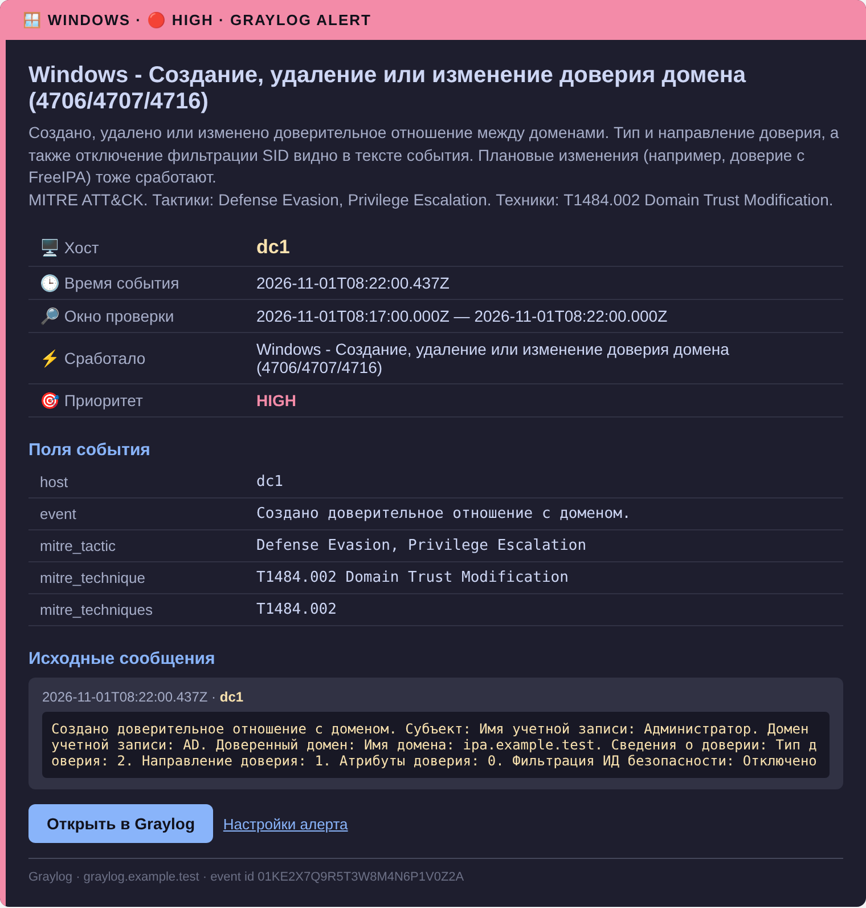

# Глава 7. Мониторинг доверий в Graylog

Доверие между доменами меняет границу безопасности: через него одни учётные записи получают доступ к ресурсам
другого домена. Поэтому создание, удаление и изменение доверия стоит видеть сразу. В MITRE ATT&CK это приём
[T1484.002, Domain Trust Modification](https://attack.mitre.org/techniques/T1484/002/) (тактики Defense
Evasion и Privilege Escalation).

Готовые алерты и вся схема сбора логов описаны в репозитории детектов
[Graylog как домашний SIEM](https://github.com/ArsIS-02/Graylog_streams-alerts). Здесь только то, что относится к
доверию.

## 7.1. События на контроллере домена

| ID | Что означает |
|---|---|
| 4706 | Создано доверительное отношение с доменом |
| 4707 | Удалено доверительное отношение с доменом |
| 4716 | Изменены сведения о доверенном домене |

В тексте событий видны: субъект (кто создал), имя и SID доверенного домена, тип и направление доверия, атрибуты
и состояние фильтрации SID. Для лесового доверия с FreeIPA фильтрация SID отключена, это штатно. Для чужих
доверий отключённая фильтрация SID заслуживает внимания: это условие атак через SID history.

### Включи аудит

Все три события относятся к подкатегории «Изменение политики проверки подлинности» (Authentication Policy
Change). Включай по GUID, чтобы не зависеть от языка Windows (PowerShell от администратора):

```powershell
auditpol /set /subcategory:"{0CCE9230-69AE-11D9-BED3-505054503030}" /success:enable /failure:enable
auditpol /get /subcategory:"{0CCE9230-69AE-11D9-BED3-505054503030}"
```

Проверь, что события пишутся:

```powershell
Get-WinEvent -FilterHashtable @{LogName='Security';Id=4706,4707,4716} -MaxEvents 10 | Format-List TimeCreated,Id,Message
```

### Отправь их в Graylog через winlogbeat

В блоке `- name: Security` в `winlogbeat.yml` добавь `4706-4707` и `4716` в `event_id`. У параметра лимит 22
записей (ID или диапазон считаются каждый за одну), поэтому, возможно, придётся убрать что-то редкое. Пример,
который работает в лаборатории (ровно 22 записи):

```yaml
  - name: Security
    ignore_older: 720h
    event_id: "1102, 4624-4625, 4648, 4662, 4672, 4688-4689, 4697-4698, 4702, 4706-4707, 4716, 4719-4726, 4728-4729, 4732-4733, 4738, 4740-4741, 4756, 4767-4769, 4771, 4776, 5136, 5140, 5145"
```

```powershell
& "C:\Program Files\winlogbeat\winlogbeat.exe" test config -c "C:\Program Files\winlogbeat\winlogbeat.yml"
Restart-Service winlogbeat
```

Winlogbeat читает журнал с текущей позиции, поэтому события, записанные до перезапуска с новым списком, в Graylog
не попадут.

## 7.2. Алерт в Graylog

Запрос в потоке Windows:

```
win_channel:Security AND win_event_id:(4706 OR 4707 OR 4716)
```

Приоритет высокий, поля MITRE: тактики `Defense Evasion, Privilege Escalation`, техника
`T1484.002 Domain Trust Modification`. Определение лежит в репозитории детектов в файле
[`windows-event-definitions.json`](https://github.com/ArsIS-02/Graylog_streams-alerts/blob/main/graylog/windows-event-definitions.json),
описание и остальные алерты контроллера домена в
[главе про Windows](https://github.com/ArsIS-02/Graylog_streams-alerts/blob/main/docs/03-windows.md#контроллер-домена-аудит-и-16-алертов-волна-2).

Алерты проверяются раз в 5 минут, поэтому письмо приходит с задержкой до нескольких минут.

Так выглядит письмо о создании доверия:



*Письмо собрано по реальному событию 4706 в том же оформлении, что и в репозитории детектов. Имена хостов и доменов заменены на вымышленные.*

## 7.3. Сторона FreeIPA

FreeIPA пишет вызовы API в `/var/log/httpd/error_log`, и в логе есть строки вида
`admin@REALM: trust_add(...): SUCCESS` или `RemoteRetrieveError` при неудаче. В репозитории детектов запрос
по этим строкам вместе с изменениями паролей, Kerberos и конфигурации даёт алерт
«FREEIPA - Изменение политик паролей, Kerberos и конфигурации (API)» (ловит и `trust_add`, и `trust_del`),
подробности в [каталоге детектов](https://github.com/ArsIS-02/Graylog_streams-alerts/blob/main/docs/14-detections.md).
Он срабатывает и на неудачные попытки, что удобно при отладке.

## 7.4. Что сработает вместе с доверием

При создании доверия в лаборатории одновременно с 4706 сработали алерты, не связанные напрямую с доверием:
сброс пароля учётной записи (4724), создание компьютерной учётной записи пользователем (4741) и изменение
привилегированных групп. Это следы создания служебных учётных записей доверия, ожидаемый шум одной операции.

## 7.5. Как проверить алерт

Реальную проверку дают сами операции: создание, удаление или пересоздание доверия (см.
[главу 4.3](04-create-trust.md)). Проверка запроса без операции: выполни его в поиске Graylog за последние
часы. Он должен вернуть события 4706, 4707 и 4716 после того, как winlogbeat начал их отправлять.
